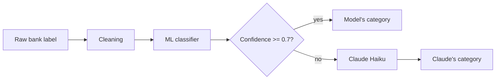

# SpendSense: Automatic Bank Transaction Categorization

SpendSense turns raw French bank statement labels like `CB CARREFOUR MARKET 12/03` or `PRLV SEPA NETFLIX.COM` into spending categories (Groceries, Subscriptions, Transport...). A fast machine learning model handles the transactions it's confident about, and Claude (Anthropic's LLM) handles the uncertain ones.

**Live demo:** https://spendsense-7n6e.onrender.com (web interface) · [API documentation](https://spendsense-7n6e.onrender.com/docs)

> Hosted on Render's free tier: after 15 minutes without traffic, the server sleeps, and the first request can take about a minute while it wakes up.

## Results at a glance

| System | Accuracy on realistic labels | Share sent to Claude |
|---|---|---|
| ML model alone | 71.7% | 0% |
| Claude alone | 95.0% | 100% |
| **ML model + Claude fallback** | **95.0%** | **60%** |

The combined system matches Claude's accuracy while sending 40% fewer transactions to the LLM: lower cost, lower latency, and the API keeps working (at model-only accuracy) if the LLM is unavailable.

## How it works



1. **Cleaning** removes what carries no category information (dates, masked card numbers, SEPA references, store codes) while keeping payment prefixes (`CB`, `PRLV`, `VIR`) and brand names.
2. **The classifier** predicts one of 12 categories with a confidence score.
3. **Below 0.7 confidence**, the label is sent to Claude, with our category definitions and taxonomy rules. Labels are batched, answers are matched by label number, and any failed call falls back to the model's prediction.

## The data

No public dataset of French bank labels exists (bank data is highly sensitive), so I generated one:

* **246 hand-picked merchants** across 12 categories, wrapped in realistic label templates for six payment types (card, direct debit, transfers in and out, ATM withdrawals, bank fees), with realistic noise (dates, real cities, card numbers, SEPA references).
* **Enriched with Claude**: the LLM suggested new real French merchants for each category, which brought the catalog to **586 merchants**.
* **Reviewed by hand**: 44 suggestions were excluded with a documented reason (wrong category, outdated organizations, misleading names). The exclusions live in code, so the review is traceable and reproducible.
* **Final dataset: 4,960 labels.** A separate set of **60 hand-written labels**, in formats from different banks and including deliberate traps, is used only for final evaluation.

## Key decisions and findings

**1. Evaluate on unseen brands, not unseen rows.** With a random train/test split, the baseline scores **98.0%**. Splitting by brand (no brand in both sets) drops it to **52.7%**. The random split measures memorization of known merchants; the brand split measures generalization to new ones. All model comparisons use brand-grouped splits and cross-validation, and the test sets were used only for final evaluations.

**2. Embeddings alone didn't beat TF-IDF, but the combination did.** In brand-grouped cross-validation (macro F1):

| Model | Macro F1 |
|---|---|
| TF-IDF + logistic regression | 50.6% ± 2.9 |
| Sentence embeddings + logistic regression | 51.6% ± 2.6 |
| **Hybrid (TF-IDF + embeddings)** | **58.0% ± 2.5** |

TF-IDF is precise on exact keywords (`FRAIS`, `CAF`, `SARL`); embeddings capture general meaning (`cinema`, `pret a manger`) but also fall for semantic false friends (`BOULANGER`, an electronics retailer, means "baker").

**3. The threshold comes from data.** Using out-of-fold predictions, I compared the model and Claude at each confidence level. Below 0.7, Claude is far more accurate (83% vs 25% under 0.4); above it, the model matches or beats Claude, because it learned the dataset's taxonomy rules.

**4. A component's gain doesn't always become a system gain.** The hybrid beats the TF-IDF model by 4 to 7 points on its own, but once Claude is added, both systems reach the same accuracy:

| System | Synthetic test (macro F1) | Realistic set (accuracy) | Sent to Claude |
|---|---|---|---|
| Hybrid + Claude | 95.9% | 95.0% | 60 to 67% |
| TF-IDF + Claude | 96.2% | 96.7% | 76 to 77% |

The better model only reduces how often Claude is needed. The free hosting tier has 512 MB of RAM, too little for the embedding model, so **the deployed API uses TF-IDF + Claude**: same accuracy, about 15 to 30% more LLM calls. The hybrid remains available locally.

## Limitations

* **Synthetic data.** Even with LLM enrichment and varied templates, generated labels are cleaner than real ones. The realistic set helps, but it only has 60 labels, so its scores are uncertain by several points.
* **Optimistic synthetic scores.** Many merchants were suggested by the same LLM used as fallback, which may recognize them more easily than truly random merchants.
* **Confident mistakes can't be rescued.** A confidence threshold only catches errors the model is unsure about. For example, a friend paying back a restaurant bill (`REMBOURSEMENT RESTO`) is predicted as Income with 91% confidence, so Claude never sees it.
* **Claude's knowledge has gaps** on small or specialized French organizations (toll operators, property agencies), and borderline cases (airlines, Airbnb, gym subscriptions) depend on taxonomy choices.
* **In-memory cache**: emptied on every restart, and not shared between servers.

## Run it locally

```bash
python -m venv .venv
.venv\Scripts\activate          # on macOS/Linux: source .venv/bin/activate
pip install -r requirements.txt
```

Create a `.env` file at the project root with your Anthropic API key:

```
ANTHROPIC_API_KEY=sk-ant-...
```

Then train the model, run the tests, and start the API:

```bash
python -m src.train              # hybrid by default; set USE_EMBEDDINGS=false for the light model
python -m pytest tests -v
uvicorn api.main:app --reload
```

The web interface is then available at http://127.0.0.1:8000, and the API documentation at http://127.0.0.1:8000/docs. Without an API key, the API still works, using the model alone.

## API usage

```bash
curl -X POST https://spendsense-7n6e.onrender.com/categorize \
  -H "Content-Type: application/json" \
  -d '{"labels": ["CB CARREFOUR MARKET 12/03", "CB KINEPOLIS 30/03"]}'
```

Each result contains the `category`, the model's `confidence`, and the `source` of the final decision (`model` or `claude`). Requests accept up to 100 labels, and results are cached per label so the same transaction always gets the same category.

## Project structure

```
├── api/                  FastAPI application
├── data/
│   ├── processed/        cleaned dataset and saved evaluation results
│   ├── llm_merchants*.json   Claude's merchant suggestions (raw and reviewed)
│   └── test_realistic.csv    60 hand-written labels for final evaluation
├── notebooks/
│   ├── 01_label_generation   designing the synthetic generator
│   ├── 02_llm_enrichment     enriching the catalog with Claude, human review
│   ├── 03_cleaning           label cleaning
│   ├── 04_baseline           TF-IDF baseline, brand split vs random split
│   ├── 05_embeddings         embeddings, cross-validation, hybrid model
│   └── 06_llm_fallback       threshold choice, Claude fallback, ablation
├── src/
│   ├── generator.py      synthetic label generator
│   ├── preprocessing.py  label cleaning
│   ├── evaluation.py     brand split, cross-validation, metrics
│   ├── classifier.py     classifier, Claude fallback, categorize()
│   └── train.py          trains and saves the final model
├── tests/                API tests (Claude is mocked)
├── Dockerfile            deployment image (trains the model during the build)
├── requirements.txt      development dependencies
└── requirements-api.txt  deployment dependencies (pinned)
```

## Tech stack

Python, pandas, scikit-learn, sentence-transformers, Anthropic API (Claude Haiku), FastAPI, Pydantic, pytest, Docker, Render.

## Possible improvements

* Run the tests automatically on every push with GitHub Actions, and deploy only when they pass.
* Build a larger realistic evaluation set, from anonymized real statements.
* Always send incoming transfers to Claude, since the model's default for unknown senders (Income) is a known blind spot.
* Try a larger embedding model or LLM on the hard cases (obscure merchants).
* Use a shared, persistent cache (such as Redis) and add rate limiting to the public API.